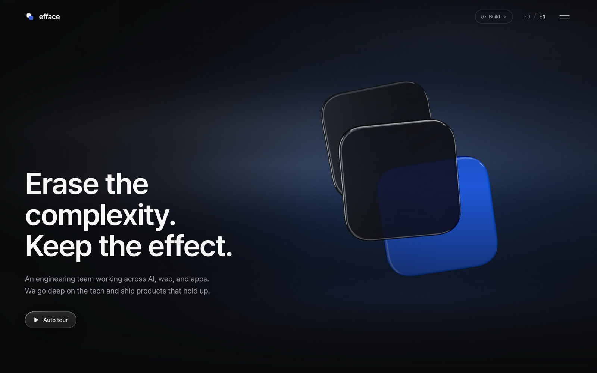
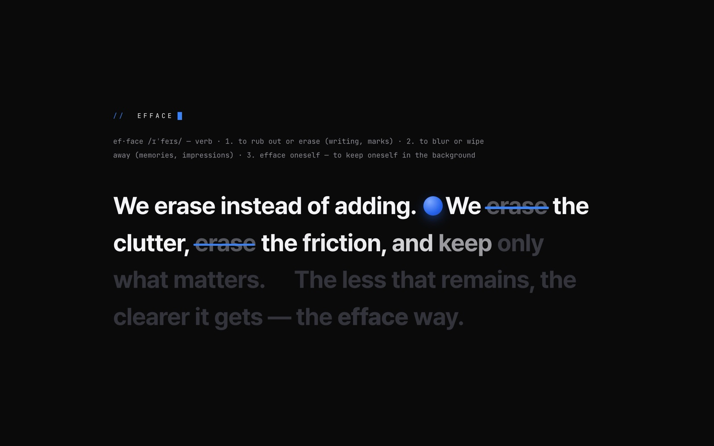
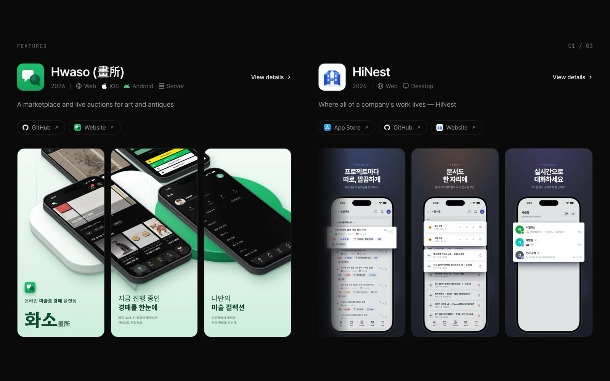
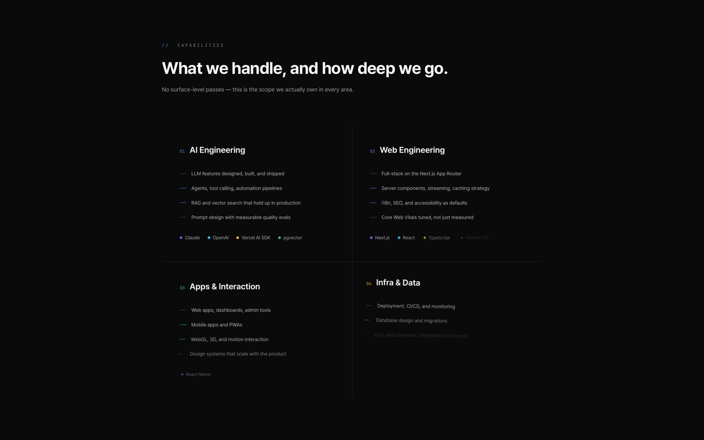
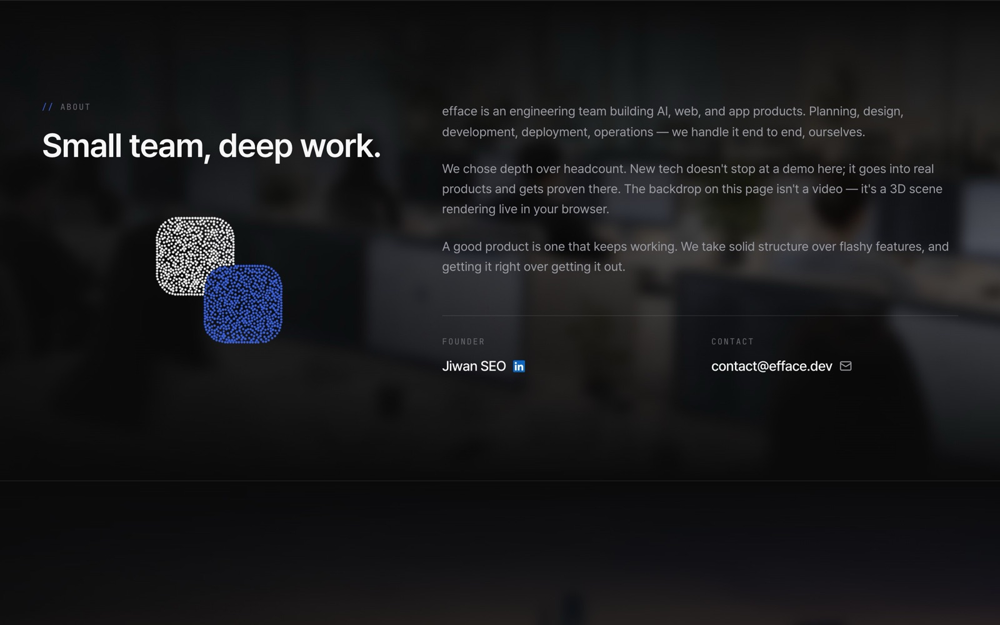
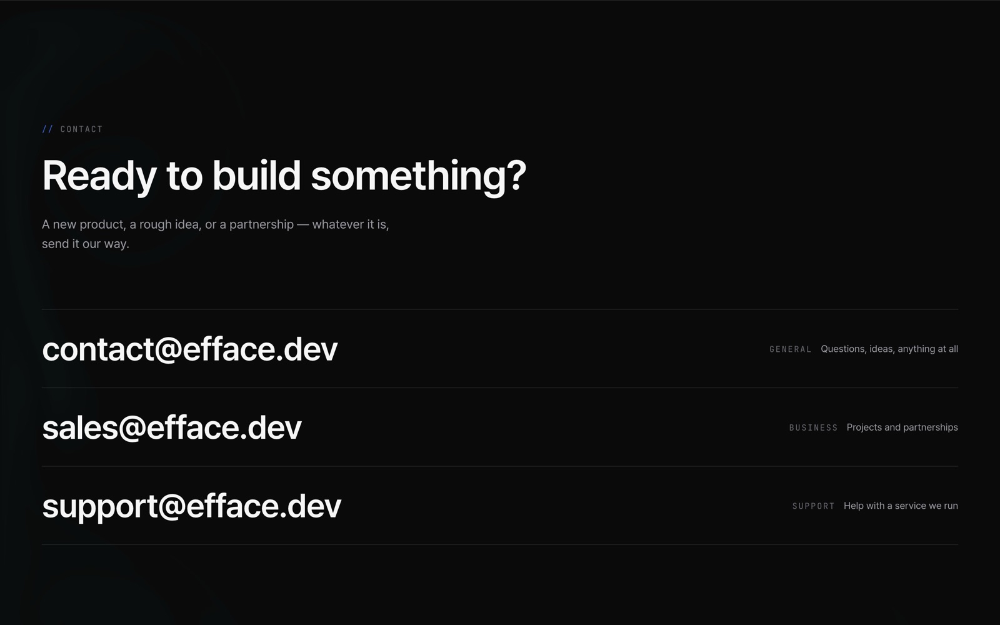
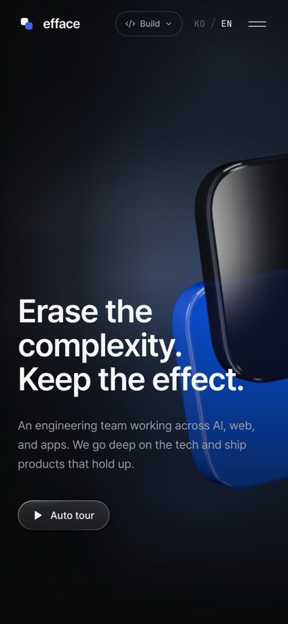
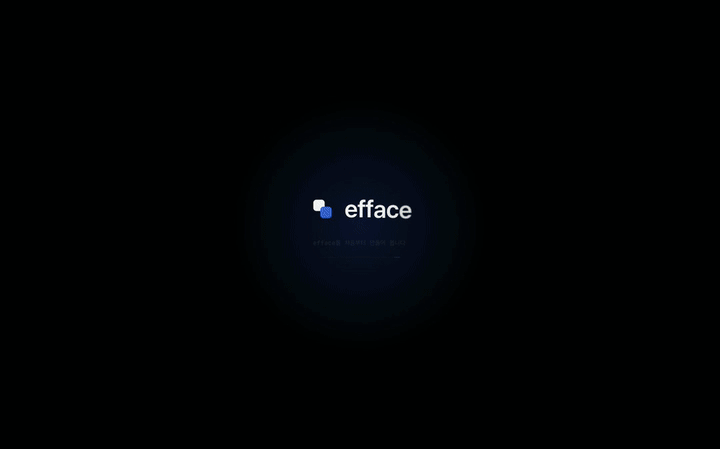
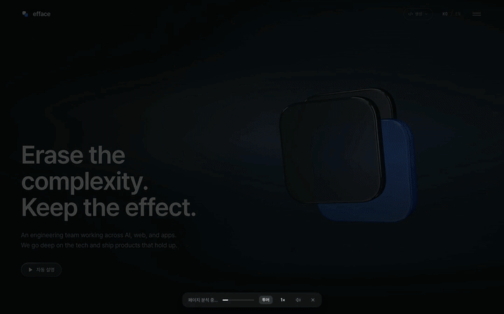

<div align="center">


# efface

**복잡함은 지우고, 효과만 남깁니다.**

AI · 웹 · 앱을 만드는 개발팀 efface의 공식 사이트입니다.

[efface.dev](https://efface.dev) · [English](https://efface.dev) · [한국어](https://efface.dev/ko)

</div>



## 사이트

한 페이지 안에서 스크롤을 따라 이야기가 이어집니다. 첫 화면의 유리 로고는 영상이 아니라
브라우저에서 바로 렌더링되는 3D 장면이고, 섹션마다 스크롤에 맞춰 움직이는 장면이 하나씩 있습니다.

| | |
| --- | --- |
|  |  |
| **efface 소개**: 스크롤하면 지우개가 화면의 잡동사니를 치우고 문장이 한 단어씩 밝아집니다. | **프로젝트**: 대표작은 화면에 고정된 채 스크린샷이 차례로 밀려 들어옵니다. 카드를 누르면 상세 페이지가 열립니다. |
|  |  |
| **할 수 있는 일**: AI, 웹, 앱, 인프라 네 영역을 실제로 쓰는 기술과 함께 정리했습니다. | **팀 소개**: 마우스를 가져가면 흩어지는 파티클 로고와 대표 소개가 있습니다. |

<p>
  
  
</p>

휴대폰에서도 같은 흐름을 그대로 볼 수 있도록 장면마다 따로 맞췄습니다.

## 생성 모드

오른쪽 위 **생성** 버튼을 누르면 사이트가 스스로 다시 만들어지는 과정을 볼 수 있습니다.
녹화해 둔 영상이 아니라, 지금 열려 있는 페이지가 브라우저 안에서 실제로 지워졌다가 다시 지어집니다.
두 가지 방식이 있고, 둘 다 1분 30초 동안 이어집니다.

**빌드 1 · 코드 에디터**: 왼쪽 미리보기, 오른쪽 VS Code. 이 저장소의 실제 소스가 한 글자씩 쳐지고,
코드가 지나가는 대로 화면에 윤곽, 글자, 색, 이미지, 애니메이션이 차례로 올라옵니다.



**빌드 2 · 스웜**: 색색의 커서 무리가 피그마에서 함께 작업하듯 페이지를 다시 그립니다.
박스를 드래그하고, 글자를 타이핑하고, 반복되는 카드는 복제해서 끌어다 놓습니다. 일이 없는 커서는 왼쪽 아래 집에서 쉽니다.



빌드 2는 [Swarm](https://califa.github.io/swarm-site/)(Joel Califa)과
[Swarm Rebuild](https://github.com/DhvanilPatel/swarm-cursors)에서 아이디어를 얻었습니다. 코드는 직접 새로 짰습니다.

## 팀


규모를 키우기보다 깊이를 택했습니다. 기획부터 디자인, 개발, 배포, 운영까지 한 팀이 끝까지 맡습니다.
문의는 [contact@efface.dev](mailto:contact@efface.dev)로 주세요.

## 개발

```bash
npm install
npm run dev        # http://localhost:3100
npm run typecheck
npm run build
```

Next.js 16(App Router) · React 19 · TypeScript · Tailwind CSS v4 · next-intl(ko/en) · motion · three.js

```
app/[locale]/        페이지(홈, 정책), 레이아웃
components/
  sections/          Hero, EffaceIntro, Work, CapabilitiesScene, Approach, About, Testimonials, Contact
  BuildMode/         생성 모드(빌드 1 스튜디오, swarm/ 빌드 2)
  three/             첫 화면 3D 유리 로고
  FluidInk/          문의 섹션 잉크 효과
  LogoParticle/      파티클 로고
messages/            ko.json / en.json — 화면의 모든 문구
public/              이미지, 폰트, 아이콘
docs/                구조 문서, README 이미지
```

구조와 컴포넌트 설명은 [`docs/frontend-architecture.md`](docs/frontend-architecture.md)에 있습니다.

## 작업 방식

이슈 → 브랜치 → PR 순서로 작업하고, PR마다 CI(타입 체크, 빌드)를 돌립니다.
배포는 Vercel(efface.dev)이며, 배포할 때마다 [GitHub Releases](https://github.com/efface-studio/efface-v2-client/releases)에 변경 내용과 검증 결과를 남깁니다.
자세한 규칙은 [`CLAUDE.md`](CLAUDE.md)를 참고하세요.
